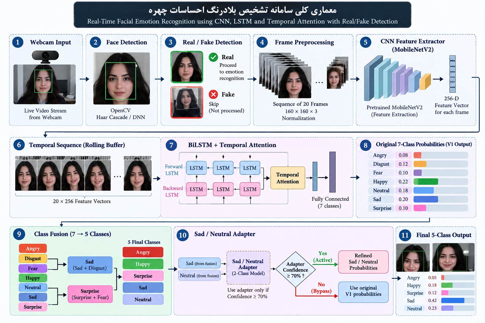
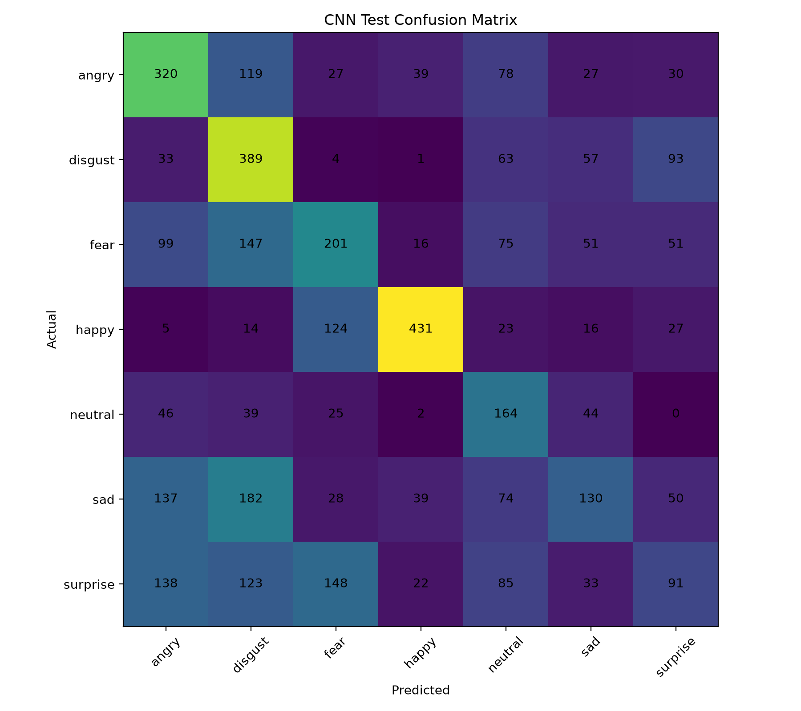
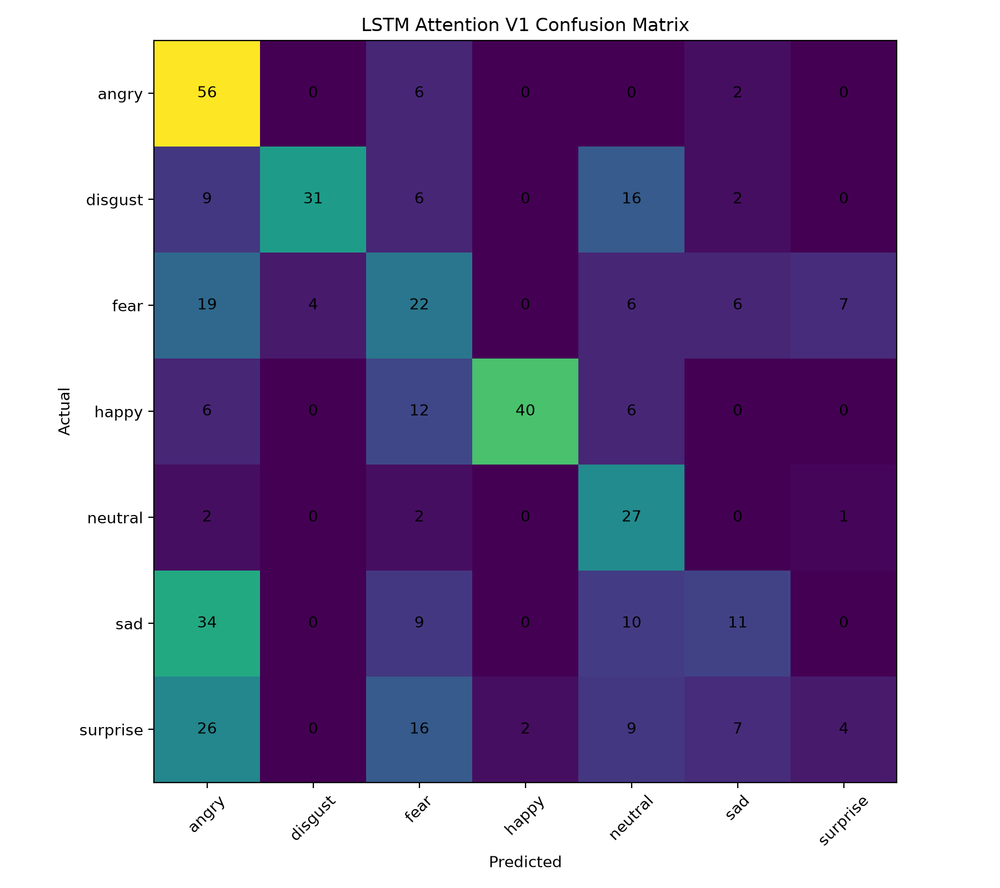

# FacialEmotionAI

[](https://www.python.org/)
[](https://www.tensorflow.org/)
[](https://opencv.org/)
[](https://git-lfs.com/)
[](LICENSE)

**FacialEmotionAI** is an end-to-end **real-time facial emotion recognition** system for webcam video. It combines spoof screening, MobileNetV2 frame features, BiLSTM + Temporal Attention, and a five-class live runtime: **Angry, Happy, Surprise, Sad, Neutral**.

## Live Web App

**Try FacialEmotionAI:** https://facialemotionai-web.onrender.com

> **Recommended input:** For the most reliable results with this demo, use the live webcam instead of uploading a video. Keep your face clearly visible, look toward the camera, and use steady, well-lit conditions. Results may vary with lighting, camera quality, and facial pose.

> **Mobile-only web app:** This demo is designed for use on a mobile phone. Please open it on your phone for the intended experience; desktop and laptop use are not supported.
>
> **VPN recommended:** If the web app does not load on your phone, try connecting to a VPN and opening the link again.

**Why it is different:** instead of classifying isolated frames only, the runtime models a rolling **20-frame temporal sequence** and places a **Real/Fake discriminator gate** before emotion inference. The repository also includes reproducible benchmarks, CI-tested inference logic, privacy-conscious data handling, and the full training pipeline.

**At a glance**
- Final five-class fusion benchmark: **52.64% accuracy / 54.73% Macro F1** on the existing actor-wise RAVDESS test protocol (416 sequences).
- Selected seven-class temporal backbone: **45.91% accuracy / 43.92% Macro F1**.
- MobileNetV2 → 256-D features → BiLSTM → Temporal Attention.
- Discriminator-based anti-spoofing before emotion inference.
- MIT licensed; built with Python 3.11, TensorFlow, and OpenCV.

[Quick start](#installation) · [Results](#main-results) · [Architecture](#architecture) · [Reproducibility](REPRODUCIBILITY.md)

> This repository is intended for research and portfolio use. It is **not** a clinical or psychological diagnostic system.

## Highlights

- Real-time webcam face detection with OpenCV.
- Real/Fake gate before emotion inference.
- MobileNetV2-based 256-D per-frame feature extraction.
- 20-frame temporal buffer.
- BiLSTM + Temporal Attention for sequence classification.
- Final five-class live output: **Angry, Happy, Surprise, Sad, Neutral**.
- Class fusion in the deployed system:
  - Fear + Surprise → Surprise
  - Disgust + Sad → Sad
- Confidence-gated Sad/Neutral adapter, activated only at **≥ 70% adapter confidence**.
- SQLite runtime logging.
- Final model artifacts stored with **Git LFS**.
- Raw datasets, webcam captures, adaptation samples, and local databases are excluded from Git.

## Driver Monitoring System

The web application also includes an experimental browser-based **Driver Monitoring System (DMS)**. It uses the webcam to analyze facial cues and detect selected driver behaviors in real time. These features are separate from the core five-class emotion-recognition pipeline described above.

### Driver monitoring features and methods

| Feature | Method / technology | What it does |
|---|---|---|
| Driver face enrollment and verification | Face-api.js, Tiny Face Detector, 68 facial landmarks, face descriptor comparison, Euclidean distance | Enrolls a face and compares a later face sample with the stored descriptor. A PIN-based check is also available in the demo. |
| Drowsiness cues | MediaPipe Face Mesh, Eye Aspect Ratio (EAR), adaptive eye-closure threshold, temporal analysis, PERCLOS-style rolling-window metric | Monitors eye closure over time and raises alerts when configured thresholds are reached. |
| Head-turn / distraction cue | Facial landmark geometry and temporal thresholding with hysteresis | Estimates left/right head movement from facial landmarks and checks whether it persists. |
| Gaze direction cue | MediaPipe Face Mesh with refined iris landmarks; normalized iris position | Estimates relative left, center, or right gaze from iris position. It is not calibrated to the road direction. |
| Yawning cue | Face-api.js mouth landmarks and mouth aspect ratio | Flags sustained mouth opening as a possible yawn. |
| Phone detection | TensorFlow.js with COCO-SSD (Lite MobileNetV2 backbone) | Detects the cell phone object class in camera frames. Object detection alone does not prove that the driver is using the phone. |
| Pedestrian detection | YOLOv8n exported to ONNX, ONNX Runtime Web with WASM | Detects the COCO person class in the browser. |
| Pedestrian tracking | Custom IoU-based association, confidence filtering, and Non-Maximum Suppression (NMS) | Associates detections across frames and displays temporary track IDs. This is a lightweight custom tracker, not the official ByteTrack implementation. |
| Virtual pedestrian-zone alert | Canvas polygon rendering, point-in-polygon test, consecutive-scan confirmation, Web Speech API | Displays a perspective-style virtual ground zone and speaks “Stop! Stop!” while a detected person's lower bounding-box point remains inside it. |

### Important implementation notes

- Most live driver-monitoring inference runs in the browser using JavaScript and browser ML libraries. Pedestrian detection uses the YOLOv8n ONNX model through ONNX Runtime Web/WASM.
- The pedestrian-zone polygon is a **virtual region in the camera image**. It is not a calibrated representation of the vehicle's real front/rear path or physical ground plane.
- The current pedestrian-zone logic does **not** measure a person's real-world distance in meters and does not implement a verified 10-meter warning boundary.
- The current demo does not establish automotive-grade reliability, road-direction gaze calibration, or integration with a vehicle's ECU, brakes, ignition, or other control systems.
- Camera placement, lighting, occlusion, and browser performance can affect results. This DMS is an experimental portfolio demonstration, not a certified driver-safety system.

## Multilingual Web Interface

The hosted web demo includes a language selector with **12 interface languages**:

- English (default on every visit)
- Persian and Arabic (right-to-left layouts)
- Spanish, French, German, Chinese, Japanese, Portuguese, Hindi, Turkish, and Russian

The selected language applies to the current visit only; the app does not save the choice for future visits or automatically select a language from the browser. The interface language changes labels and status messages, while the underlying emotion-recognition model and API remain the same.

## Project Ownership & Contributions

**Project Creator & Lead Developer:** Arian Harashchi

I designed, developed, and implemented the core components of FacialEmotionAI, including the facial emotion recognition pipeline, deep learning models, anti-spoofing integration, video analysis, API, and web application deployment.

**Additional Contribution:** A collaborator contributed to the project's video presentation.

The core architecture, model integration, implementation, testing, and deployment were primarily developed and managed by the project creator.

## Architecture Video

[](https://d2ol7oe51mr4n9.cloudfront.net/user_3K8P0B0phId4N0d4AmHg2YA7msy/64ba4a94-ab30-41b0-ba02-790aad338b3d.mp4)

**▶ [Watch the narrated architecture walkthrough](https://d2ol7oe51mr4n9.cloudfront.net/user_3K8P0B0phId4N0d4AmHg2YA7msy/64ba4a94-ab30-41b0-ba02-790aad338b3d.mp4)**  
Grady voice · English subtitles · training pipeline, anti-spoofing, temporal inference, class fusion, and Sad/Neutral refinement.

## Architecture


*High-level architecture of the FacialEmotionAI training and live-inference pipeline, including anti-spoofing, temporal emotion modeling, seven-to-five class fusion, and Sad/Neutral adapter refinement.*

**Interactive codebase map:** [Explore FacialEmotionAI on GitDiagram](https://gitdiagram.com/arianharashchi-lang/FacialEmotionAI)

> GitDiagram is an automatically generated repository overview. It is useful for navigating the codebase quickly, while this README and the source files remain the authoritative reference for runtime behavior, confidence calibration, and evaluation details.

```text
Webcam
  ↓
OpenCV Face Detection
  ↓
Real/Fake Gate
  ↓
MobileNetV2 CNN Feature Extractor
  ↓
256-D feature vector / sampled frame
  ↓
Rolling Buffer: 20 × 256
  ↓
BiLSTM
  ↓
Temporal Attention
  ↓
Original 7-class probabilities
  ↓
Class Fusion
  ├── Fear + Surprise → Surprise
  └── Disgust + Sad   → Sad
  ↓
5-class live output
  ↓
Sad/Neutral adapter
  └── applied only when confidence ≥ 70%
```

## Final emotion classes

| Live class | Source |
|---|---|
| Angry | Original Angry probability |
| Happy | Original Happy probability |
| Surprise | Surprise + Fear |
| Sad | Sad + Disgust |
| Neutral | Original Neutral, refined by the gated adapter when applicable |

## Dataset and evaluation protocol

The temporal emotion model was trained from **RAVDESS** video sequences.

Actor-wise split:

```text
Actors 01–16 → Train
Actors 17–20 → Validation
Actors 21–24 → Test
```

This split reduces identity leakage between training and evaluation.

Each temporal sequence contains:

```text
20 frames × 160 × 160 × 3
```

After CNN feature extraction:

```text
20 × 256
```

Raw RAVDESS files are intentionally **not included** in this repository.

## Main results

| Model / deployment mode | Test Accuracy | Macro F1 |
|---|---:|---:|
| CNN baseline (7-class) | 41.49% | 40.00% |
| **LSTM V1 Rebuild (7-class)** | **45.91%** | **43.92%** |
| LSTM V2 (7-class) | 43.27% | 36.18% |
| LSTM V3 (7-class) | 44.23% | 41.95% |
| LSTM V4 (7-class) | 43.27% | 41.82% |
| **Final 5-class fusion only** | **52.64%** | **54.73%** |
| Final 5-class + adapter | 46.39% | 45.45% |

The deployed temporal backbone is **LSTM V1 Rebuild**. The five-class benchmark uses the existing unseen-actor RAVDESS test split (Actors 21–24, 416 sequences). Because class fusion changes the task, the five-class scores are not directly comparable to the original seven-class scores as a pure model-improvement claim.

### Sad / Neutral webcam adapter

Person-wise cross-validation across two participants:

| Metric | Mean |
|---|---:|
| Accuracy | 63.75% |
| Macro F1 | 57.22% |
| Neutral F1 | 69.90% |
| Sad F1 | 44.55% |

These adapter metrics are based on only two participants and **must not be interpreted as general-population performance**.

For full metrics, plots, confusion matrices, and evaluation caveats, see [RESULTS.md](RESULTS.md).

## Visual results

### CNN confusion matrix



### LSTM V1 confusion matrix



### Public demo screenshots

Face-containing webcam screenshots are **not committed by default** to protect participant privacy. See [docs/screenshots/README.md](docs/screenshots/README.md) for the opt-in policy.

## Installation

### 1. Clone with Git LFS

```powershell
git lfs install
git clone https://github.com/arianharashchi-lang/FacialEmotionAI.git
cd FacialEmotionAI
git lfs pull
```

### 2. Create a Python environment

Recommended: **Python 3.11**

```powershell
python -m venv .venv
.venv\Scripts\activate
python -m pip install --upgrade pip
pip install -r requirements.txt
```

## Run the final system

```powershell
python main_5class.py
```

Controls:

```text
R = Reset temporal buffer
Q = Quit
```

At runtime the application creates local folders for captured faces and SQLite logging. Those files are ignored by Git.

## Final runtime files

```text
main_5class.py
emotion_detector_5class.py
fake_detector.py

models/
├── cnn_feature_extractor.keras
├── fake_discriminator.keras
├── lstm_attention_v1_best.keras
├── lstm_attention_v1_classes.json
├── lstm_v1_feature_mean.npy
├── lstm_v1_feature_std.npy
├── sad_neutral_adapter.keras
└── sad_neutral_adapter_classes.json
```

## Repository layout

```text
FacialEmotionAI/
├── main_5class.py
├── emotion_detector_5class.py
├── fake_detector.py
├── train_*.py                  # training / experiment scripts
├── prepare_*.py                # dataset preparation
├── extract_*.py                # feature extraction
├── collect_*.py                # local data collection utilities
├── download_prepare_ravdess.py
├── models/                     # final runtime artifacts only
├── results/
│   ├── cnn/
│   ├── lstm_v1/
│   ├── anti_spoofing/
│   ├── adapter/
│   └── experiments/
├── archive/
│   └── legacy_runtime/         # historical runtime prototypes
├── docs/
│   ├── architecture.png
│   └── screenshots/
├── .github/workflows/
├── README.md
├── RESULTS.md
├── REPRODUCIBILITY.md
├── RELEASE_NOTES.md
├── CONTRIBUTING.md
├── requirements.txt
├── .gitignore
├── .gitattributes
└── LICENSE
```

## Development tests

The class-fusion, probability handling, confidence policy, and Sad/Neutral adapter gate are covered by lightweight unit tests that do not require a webcam, private datasets, or TensorFlow model loading.

```powershell
pip install -r requirements-dev.txt
python -m pytest -q
```

GitHub Actions runs both Python syntax compilation and these unit tests for pushes and pull requests targeting `main`.

## Reproducing training

The repository keeps the training and preprocessing code but excludes large/raw datasets and private webcam captures.

See [REPRODUCIBILITY.md](REPRODUCIBILITY.md) for the complete pipeline.

## Anti-spoofing terminology

The runtime uses the trained **discriminator** as the Real/Fake gate. The repository contains generator/discriminator architecture code, but the current training pipeline for the released anti-spoofing model is supervised discriminator training on Real/Fake examples. For that reason, the project is described here as **discriminator-based anti-spoofing**, rather than claiming that the released model was trained end-to-end as a GAN.

## Privacy and repository hygiene

The following are intentionally excluded from version control:

- RAVDESS archives and generated datasets
- webcam adaptation sequences and extracted webcam features
- captured face images
- SQLite databases
- virtual environments
- local pretrained MobileNet weight files
- temporary downloads and logs

Do not commit participant face data without explicit consent.

## Limitations

- RAVDESS contains acted emotions and only 24 actors.
- Real-world pose, lighting, camera quality, occlusion, and identity variation can reduce performance.
- The final five-class deployment has been benchmarked on Actors 21–24, but that same test split was also used during earlier model comparison, so it is not a pristine post-selection benchmark.
- The Sad/Neutral adapter was evaluated on only two participants.
- Anti-spoofing metrics depend on the collected Real/Fake dataset and should not be interpreted as universal spoof-detection performance.
- Softmax scores are model confidence values, not psychological certainty.

## Future work

- Evaluate the final five-class system on a new external or otherwise untouched unseen-person benchmark.
- Expand real-world multi-person data collection with explicit consent.
- Improve anti-spoofing evaluation across print, display, replay, and synthetic attacks.
- Add face tracking for stable temporal identity continuity.
- Calibrate confidence scores and decision thresholds.
- Add a public demo only with privacy-safe or explicitly consented media.

## License

MIT — see [LICENSE](LICENSE).
