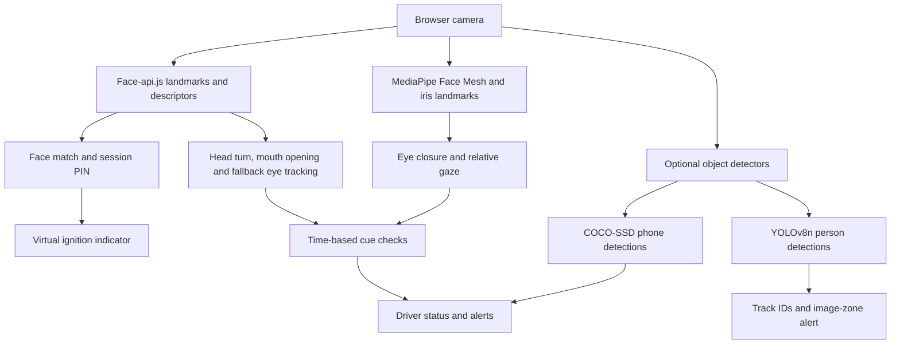

# Driver Monitoring

An experimental browser-based dashboard for exploring what a single camera can tell us about a driver. The dashboard tracks eye closure, head turns, mouth opening and relative gaze over time. Two optional detectors look for phones and people in the same camera view. FastAPI serves the dashboard at `/driver`, and JavaScript processes the camera frames in the browser.

[Open the driver dashboard](https://facialemotionai-web.onrender.com/driver) · [Run locally](#run-the-driver-dashboard-locally) · [Architecture](#how-the-dashboard-works)

## Try a monitoring session

1. Open the dashboard on a phone over HTTPS, tap **Start camera**, and allow camera access. Face the camera in steady light and keep your eyes visible while the eye tracker estimates your open-eye baseline. The first session needs network access to load browser models.
2. Watch the eye state and closure duration as you blink, then turn your head and watch the head indicator. The rolling eye-closure percentage needs at least 10 seconds of observations. If face tracking drops, check the tracking status and bring your face back into view.
3. To hear fatigue warnings, select **Enable audio alerts** and **Test Wake up voice**. Enable phone or pedestrian detection separately to try each extra model. For the pedestrian demo, point the camera toward a person and watch where their tracked box meets the shaded zone.
4. Select **Export session CSV** for the event log or **Download full session report (HTML)** for a session summary. Use **Stop camera** when finished.

## How the dashboard works



| Signal | How to read the output |
|---|---|
| Eye closure | The eye aspect ratio measures eyelid opening. The fatigue check flags continuous closure of at least 1.5 seconds or closure during at least 40% of observed time in a rolling 30-second window. If Face Mesh cannot initialize, face-api.js supplies a slower eye estimate. |
| Head and mouth | Nose displacement relative to the eyes indicates a head turn. A turn lasting 0.8 seconds triggers the distraction cue. Sustained mouth opening for 1.2 seconds counts as a possible yawn. |
| Relative gaze | Iris position within both eyes gives a left, center or right estimate. Two seconds on the same side triggers a sustained-gaze cue. Closed eyes, a turned head or unusable iris landmarks give an unknown reading. |
| Phone visibility | COCO-SSD checks for the cell phone class across repeated scans. A warning means a phone remained visible in the camera view. |
| Pedestrian zone | YOLOv8n runs through ONNX Runtime Web. A tracker associates boxes by overlap. Two consecutive scans with a tracked box’s bottom midpoint inside the polygon activate the zone alert. |

These thresholds describe the demo’s behavior. Gaze is relative to the camera, and the pedestrian polygon uses image coordinates without a distance scale. Camera placement, lighting and occlusion affect both. Use the dashboard as a stationary demonstration. Its alerts have no validated road-safety performance.

### Simulated driver verification

With the participant’s consent, enter a temporary PIN of at least six characters and select **Enroll current face**. The tab holds a face descriptor and a PIN hash in memory. **Verify driver & PIN** compares a fresh descriptor and checks the PIN. Passing both changes the on-screen virtual ignition to **AUTHORIZED (SIMULATION)**. Five failed checks pause verification for 30 seconds. The demo has no connection to vehicle hardware.

## Run the driver dashboard locally

Use Python 3.11 and Git LFS. From a terminal, clone this repository and create a virtual environment.

```sh
git lfs install
git clone https://github.com/arianharashchi-lang/Driver_-monitoring.git
cd Driver_-monitoring
git lfs pull
python -m venv .venv
```

Activate it with `source .venv/bin/activate` on macOS or Linux, or `.\.venv\Scripts\Activate.ps1` in Windows PowerShell. Then run the following from the repository root.

```sh
python -m pip install -r requirements.txt -r webapp/requirements.txt
python -m uvicorn webapp.app:app --port 8000
```

Open the [local driver dashboard](http://127.0.0.1:8000/driver) on the computer running the server. Camera access requires localhost or HTTPS. The root route opens the separate facial-expression demo.

## Implementation guide

| Source | Responsibility |
|---|---|
| [Driver dashboard](webapp/templates/driver.html) and [camera controller](webapp/static/driver.js) | Camera lifecycle, enrollment, landmark processing, phone scans and spoken warnings |
| [Fatigue metrics](webapp/static/driver-metrics.js) and [gaze tracker](webapp/static/driver-gaze.js) | Rolling closure percentage, blink counts and duration checks for driver cues |
| [Pedestrian detector](webapp/static/pedestrian.js) | ONNX inference, bounding-box association and polygon checks |
| [Session analytics](webapp/static/driver-analytics.js) | Event summaries and downloadable HTML report |
| [JavaScript tests](tests/js/) | Test cases for driver metrics, gaze and session analytics |

## FacialEmotionAI

**FacialEmotionAI** is an end-to-end **real-time facial emotion recognition** system for webcam video. It combines spoof screening, MobileNetV2 frame features, BiLSTM + Temporal Attention, and a five-class live runtime: **Angry, Happy, Surprise, Sad, Neutral**.

The webcam runtime screens each detected face with a Real/Fake discriminator. MobileNetV2 extracts a 256-dimensional feature vector per sampled frame, and the temporal model reads a rolling window of 20 frames. The live classifier combines Fear with Surprise and Disgust with Sad. An optional adapter refines Sad and Neutral predictions when its confidence reaches 70%.

### Training, validation and test splits

RAVDESS recordings are grouped by actor so that each person appears in one split. The temporal models classify video sequences. The CNN baseline classifies individual frames.

| Split | RAVDESS actor IDs | Actors | Use |
|---|---|---:|---|
| Training | 01–16 | 16 | Fit model weights |
| Validation | 17–20 | 4 | Monitor training and compare checkpoints |
| Test | 21–24 | 4 | Evaluate expression predictions on unseen actors |

### Expression recognition results

Accuracy counts the fraction of correct predictions. Macro F1 gives each expression class equal weight. The V3 training log records both training and validation accuracy. The row below uses the epoch with the highest validation Macro F1.

| Validation checkpoint | Training accuracy | Validation accuracy | Validation Macro F1 |
|---|---:|---:|---:|
| LSTM V3, first epoch | 48.02% | 49.03% | 46.90% |

[Epoch-by-epoch training and validation log](results/experiments/v3/lstm_attention_v3_training.csv)

| Model or deployment mode | Classes | Test accuracy | Test Macro F1 |
|---|---:|---:|---:|
| CNN baseline | 7 | 41.49% | 40.00% |
| **LSTM V1 Rebuild** (selected backbone) | 7 | **45.91%** | **43.92%** |
| LSTM V2 | 7 | 43.27% | 36.18% |
| LSTM V3 | 7 | 44.23% | 41.95% |
| LSTM V4 | 7 | 43.27% | 41.82% |
| **Five-class fusion** | 5 | **52.64%** | **54.73%** |
| Five-class fusion with Sad/Neutral adapter | 5 | 46.39% | 45.45% |

The CNN test covers 4,160 frames. The temporal and fusion results cover 416 sequences. Merging classes changes the prediction task, and the same test actors were used in earlier model comparisons. These figures measure facial-expression classification. The driver dashboard’s fatigue and distraction cues use separate browser-based rules.

[Open the expression demo](https://facialemotionai-web.onrender.com) · [Full evaluation and per-class scores](RESULTS.md) · [Architecture and setup](docs/facial-emotion-ai.md)

## Credits and license

Created by Arian Harashchi. Released under the [MIT License](LICENSE).
