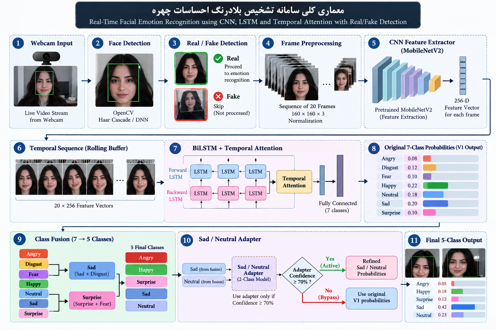
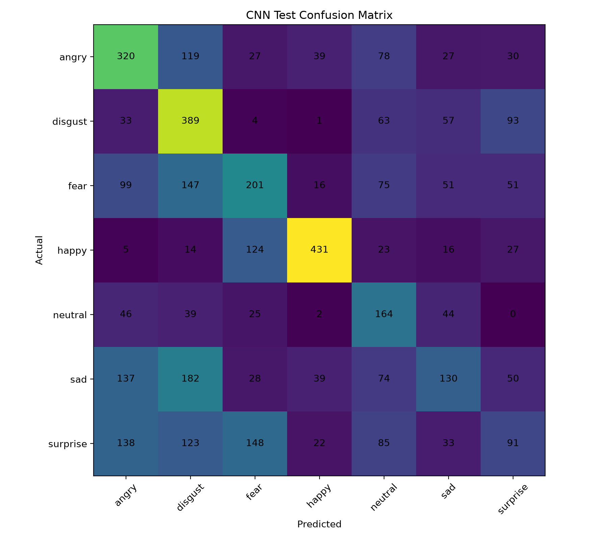
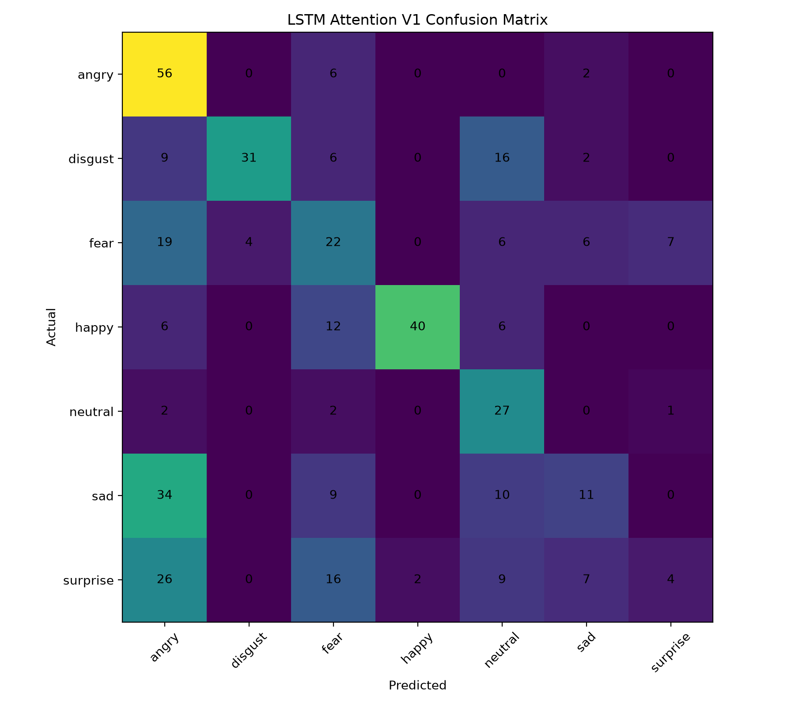

# FacialEmotionAI

[](https://www.python.org/)
[](https://www.tensorflow.org/)
[](https://opencv.org/)
[](https://git-lfs.com/)
[](LICENSE)

A portfolio/research project for **real-time facial emotion recognition** using OpenCV, a MobileNetV2 CNN feature extractor, BiLSTM + Temporal Attention, discriminator-based anti-spoofing, and a confidence-gated Sad/Neutral webcam adapter.

> This repository is intended for research and portfolio use. It is **not** a clinical or psychological diagnostic system.

## Highlights

- Real-time webcam face detection with OpenCV.
- Real/Fake gate before emotion inference.
- MobileNetV2-based 256-D per-frame feature extraction.
- 20-frame temporal buffer.
- BiLSTM + Temporal Attention for sequence classification.
- Final five-class live output: **Angry, Happy, Surprise, Sad, Neutral**.
- Class fusion in the deployed system:
  - Fear + Surprise → Surprise
  - Disgust + Sad → Sad
- Confidence-gated Sad/Neutral adapter, activated only at **≥ 70% adapter confidence**.
- SQLite runtime logging.
- Final model artifacts stored with **Git LFS**.
- Raw datasets, webcam captures, adaptation samples, and local databases are excluded from Git.

## Architecture



```text
Webcam
  ↓
OpenCV Face Detection
  ↓
Real/Fake Gate
  ↓
MobileNetV2 CNN Feature Extractor
  ↓
256-D feature vector / sampled frame
  ↓
Rolling Buffer: 20 × 256
  ↓
BiLSTM
  ↓
Temporal Attention
  ↓
Original 7-class probabilities
  ↓
Class Fusion
  ├── Fear + Surprise → Surprise
  └── Disgust + Sad   → Sad
  ↓
5-class live output
  ↓
Sad/Neutral adapter
  └── applied only when confidence ≥ 70%
```

## Final emotion classes

| Live class | Source |
|---|---|
| Angry | Original Angry probability |
| Happy | Original Happy probability |
| Surprise | Surprise + Fear |
| Sad | Sad + Disgust |
| Neutral | Original Neutral, refined by the gated adapter when applicable |

## Dataset and evaluation protocol

The temporal emotion model was trained from **RAVDESS** video sequences.

Actor-wise split:

```text
Actors 01–16 → Train
Actors 17–20 → Validation
Actors 21–24 → Test
```

This split reduces identity leakage between training and evaluation.

Each temporal sequence contains:

```text
20 frames × 160 × 160 × 3
```

After CNN feature extraction:

```text
20 × 256
```

Raw RAVDESS files are intentionally **not included** in this repository.

## Main results

| Model | Test Accuracy | Macro F1 |
|---|---:|---:|
| CNN baseline | 41.49% | 40.00% |
| **LSTM V1 Rebuild** | **45.91%** | **43.92%** |
| LSTM V2 | 43.27% | 36.18% |
| LSTM V3 | 44.23% | 41.95% |
| LSTM V4 | 43.27% | 41.82% |

The deployed temporal backbone is **LSTM V1 Rebuild**.

### Sad / Neutral webcam adapter

Person-wise cross-validation across two participants:

| Metric | Mean |
|---|---:|
| Accuracy | 63.75% |
| Macro F1 | 57.22% |
| Neutral F1 | 69.90% |
| Sad F1 | 44.55% |

These adapter metrics are based on only two participants and **must not be interpreted as general-population performance**.

For full metrics, plots, confusion matrices, and evaluation caveats, see [RESULTS.md](RESULTS.md).

## Visual results

### CNN confusion matrix



### LSTM V1 confusion matrix



### Public demo screenshots

Face-containing webcam screenshots are **not committed by default** to protect participant privacy. See [docs/screenshots/README.md](docs/screenshots/README.md) for the opt-in policy.

## Installation

### 1. Clone with Git LFS

```powershell
git lfs install
git clone https://github.com/arianharashchi-lang/FacialEmotionAI.git
cd FacialEmotionAI
git lfs pull
```

### 2. Create a Python environment

Recommended: **Python 3.11**

```powershell
python -m venv .venv
.venv\Scripts\activate
python -m pip install --upgrade pip
pip install -r requirements.txt
```

## Run the final system

```powershell
python main_5class.py
```

Controls:

```text
R = Reset temporal buffer
Q = Quit
```

At runtime the application creates local folders for captured faces and SQLite logging. Those files are ignored by Git.

## Final runtime files

```text
main_5class.py
emotion_detector_5class.py
fake_detector.py

models/
├── cnn_feature_extractor.keras
├── fake_discriminator.keras
├── lstm_attention_v1_best.keras
├── lstm_attention_v1_classes.json
├── lstm_v1_feature_mean.npy
├── lstm_v1_feature_std.npy
├── sad_neutral_adapter.keras
└── sad_neutral_adapter_classes.json
```

## Repository layout

```text
FacialEmotionAI/
├── main_5class.py
├── emotion_detector_5class.py
├── fake_detector.py
├── train_*.py                  # training / experiment scripts
├── prepare_*.py                # dataset preparation
├── extract_*.py                # feature extraction
├── collect_*.py                # local data collection utilities
├── download_prepare_ravdess.py
├── models/                     # final runtime artifacts only
├── results/
│   ├── cnn/
│   ├── lstm_v1/
│   ├── anti_spoofing/
│   ├── adapter/
│   └── experiments/
├── archive/
│   └── legacy_runtime/         # historical runtime prototypes
├── docs/
│   ├── architecture.png
│   └── screenshots/
├── .github/workflows/
├── README.md
├── RESULTS.md
├── REPRODUCIBILITY.md
├── RELEASE_NOTES.md
├── CONTRIBUTING.md
├── requirements.txt
├── .gitignore
├── .gitattributes
└── LICENSE
```

## Reproducing training

The repository keeps the training and preprocessing code but excludes large/raw datasets and private webcam captures.

See [REPRODUCIBILITY.md](REPRODUCIBILITY.md) for the complete pipeline.

## Anti-spoofing terminology

The runtime uses the trained **discriminator** as the Real/Fake gate. The repository contains generator/discriminator architecture code, but the current training pipeline for the released anti-spoofing model is supervised discriminator training on Real/Fake examples. For that reason, the project is described here as **discriminator-based anti-spoofing**, rather than claiming that the released model was trained end-to-end as a GAN.

## Privacy and repository hygiene

The following are intentionally excluded from version control:

- RAVDESS archives and generated datasets
- webcam adaptation sequences and extracted webcam features
- captured face images
- SQLite databases
- virtual environments
- local pretrained MobileNet weight files
- temporary downloads and logs

Do not commit participant face data without explicit consent.

## Limitations

- RAVDESS contains acted emotions and only 24 actors.
- Real-world pose, lighting, camera quality, occlusion, and identity variation can reduce performance.
- The final 5-class class-fusion deployment was not independently re-benchmarked as a new held-out 5-class test set.
- The Sad/Neutral adapter was evaluated on only two participants.
- Anti-spoofing metrics depend on the collected Real/Fake dataset and should not be interpreted as universal spoof-detection performance.
- Softmax scores are model confidence values, not psychological certainty.

## Future work

- Evaluate the final five-class system on a larger unseen-person benchmark.
- Expand real-world multi-person data collection with explicit consent.
- Improve anti-spoofing evaluation across print, display, replay, and synthetic attacks.
- Add face tracking for stable temporal identity continuity.
- Calibrate confidence scores and decision thresholds.
- Add a public demo only with privacy-safe or explicitly consented media.

## License

MIT — see [LICENSE](LICENSE).
