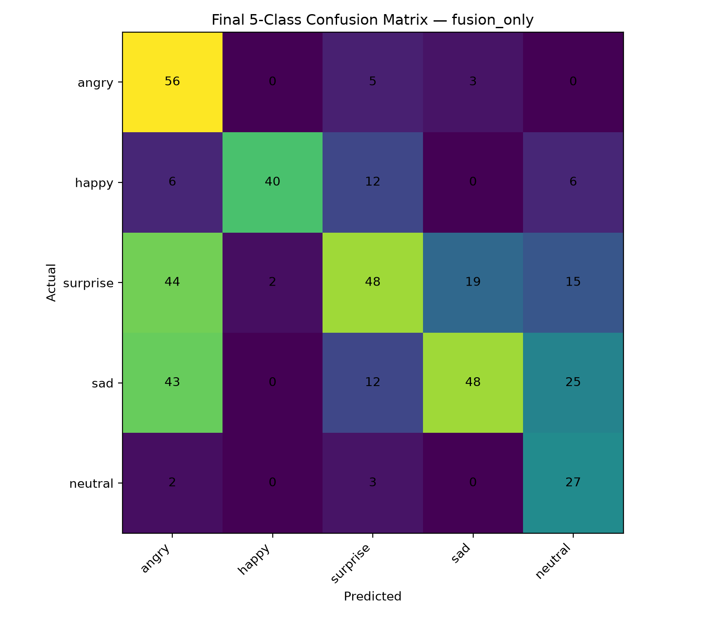
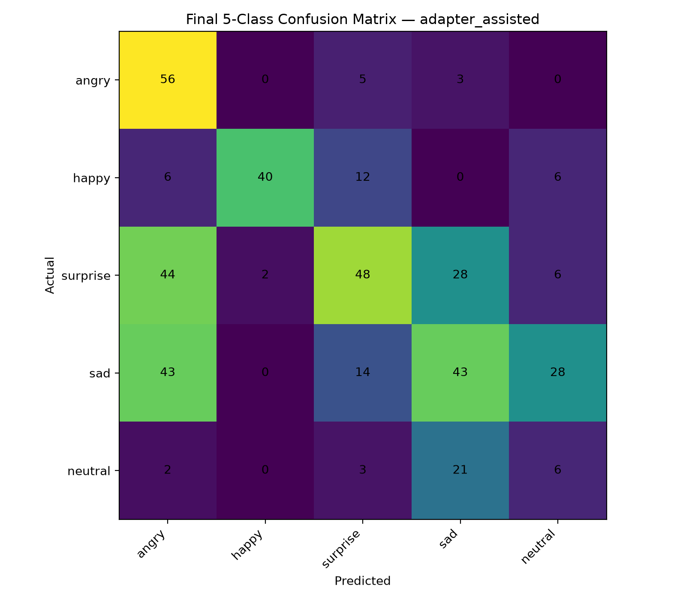

# Results

This page summarizes the evaluation artifacts committed with FacialEmotionAI.

## Evaluation protocol

The core CNN/LSTM emotion results use an **actor-wise RAVDESS split**:

- Train: Actors 01–16
- Validation: Actors 17–20
- Test: Actors 21–24

This is stricter than a random frame split because identities in the test set are unseen during training.

## CNN baseline

- Test Accuracy: **41.49%**
- Macro F1: **40.00%**
- Weighted F1: **40.22%**

Raw report: [results/cnn/cnn_test_report.txt](results/cnn/cnn_test_report.txt)

## LSTM V1 Rebuild

- Test Accuracy: **45.91%**
- Macro F1: **43.92%**
- Weighted F1: **43.38%**

Raw report: [results/lstm_v1/lstm_attention_v1_test_report.txt](results/lstm_v1/lstm_attention_v1_test_report.txt)

The temporal model improved test accuracy by about **4.42 percentage points** over the static CNN baseline.

## Temporal experiments

| Model | Test Accuracy | Macro F1 | Status |
|---|---:|---:|---|
| V1 Rebuild | **45.91%** | **43.92%** | Selected |
| V2 | 43.27% | 36.18% | Experiment |
| V3 | 44.23% | 41.95% | Experiment |
| V4 | 43.27% | 41.82% | Experiment |

Experimental artifacts are kept under `results/experiments/` for transparency.

## Sad / Neutral adapter

Person-wise cross-validation across two participants:

- Mean Accuracy: **63.75%**
- Mean Macro F1: **57.22%**
- Mean Neutral F1: **69.90%**
- Mean Sad F1: **44.55%**

Raw metrics:
- [results/adapter/sad_neutral_adapter_metrics.json](results/adapter/sad_neutral_adapter_metrics.json)
- [results/adapter/sad_neutral_adapter_cv_report.txt](results/adapter/sad_neutral_adapter_cv_report.txt)

### Important limitation

This adapter was evaluated on only two participants. The score is useful as a development signal, but it is **not a population-level estimate**.

## Anti-spoofing

The committed anti-spoofing metric file reports perfect performance on the project-specific evaluation split. That result should be interpreted only in the context of the collected dataset and split, not as universal spoof-detection accuracy.

See:
- [results/anti_spoofing/fake_detector_metrics.json](results/anti_spoofing/fake_detector_metrics.json)
- [results/anti_spoofing/fake_detector_confusion_matrix.png](results/anti_spoofing/fake_detector_confusion_matrix.png)

## Final five-class deployment benchmark

The live system merges:
- Fear into Surprise
- Disgust into Sad

and optionally refines Sad/Neutral using the confidence-gated adapter.

The final five-class logic was benchmarked on the existing actor-wise RAVDESS test split (**Actors 21–24, 416 sequences**). Ground-truth labels were fused using the same deployment mapping.

### Summary

| Evaluation mode | Accuracy | Macro F1 | Weighted F1 |
|---|---:|---:|---:|
| **Fusion only** | **52.64%** | **54.73%** | **52.70%** |
| Adapter assisted | 46.39% | 45.45% | 46.74% |

The adapter activated on **101 / 416 sequences (24.3%)**.

### Fusion-only per-class results

| Final class | Precision | Recall | F1 | Support |
|---|---:|---:|---:|---:|
| Angry | 0.37 | 0.88 | 0.52 | 64 |
| Happy | 0.95 | 0.62 | 0.75 | 64 |
| Surprise | 0.60 | 0.38 | 0.46 | 128 |
| Sad | 0.69 | 0.38 | 0.48 | 128 |
| Neutral | 0.37 | 0.84 | 0.51 | 32 |

Raw report: [results/final_5class/fusion_only_report.txt](results/final_5class/fusion_only_report.txt)

### Adapter-assisted per-class results

| Final class | Precision | Recall | F1 | Support |
|---|---:|---:|---:|---:|
| Angry | 0.37 | 0.88 | 0.52 | 64 |
| Happy | 0.95 | 0.62 | 0.75 | 64 |
| Surprise | 0.59 | 0.38 | 0.46 | 128 |
| Sad | 0.45 | 0.34 | 0.39 | 128 |
| Neutral | 0.13 | 0.19 | 0.15 | 32 |

Raw report: [results/final_5class/adapter_assisted_report.txt](results/final_5class/adapter_assisted_report.txt)

Full machine-readable metrics: [results/final_5class/final_5class_metrics.json](results/final_5class/final_5class_metrics.json)

### Interpretation

On this RAVDESS split, **fusion only outperformed adapter-assisted inference**. This is consistent with the adapter being trained on a very small, private two-participant webcam dataset and then evaluated here across a different domain.

This result should **not** be interpreted as evidence that the adapter is universally harmful. Its intended use is webcam adaptation, and its two-person dataset is too small for population-level conclusions.

The five-class scores also should not be treated as a direct apples-to-apples model improvement over the original seven-class metrics, because merging classes changes the prediction task and makes some previously distinct errors count as correct.

### Evaluation caveat

Actors 21–24 were unseen during model training, but this is **not a pristine post-selection benchmark**: the same actor-wise test split was used during earlier temporal-model comparison. A stronger future result would use a new external or otherwise untouched evaluation set.
